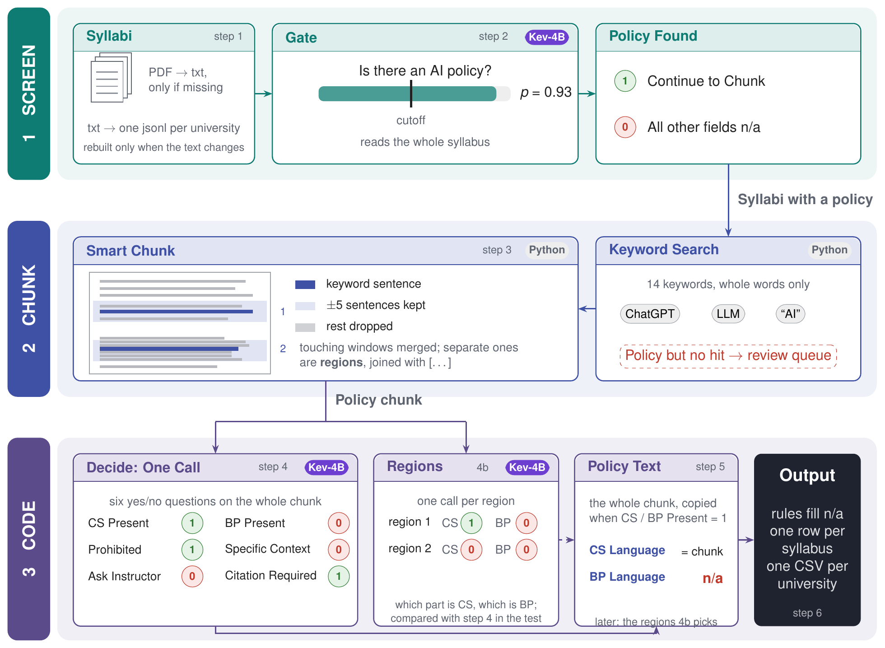

# AI Syllabus Project

A pipeline that reads university course syllabi and codes each one's **AI policy**: is there a policy on students'
use of AI tools, and if so, is it written for the course or taken from the institution, does it prohibit AI, allow it
for some tasks, defer to the instructor, or require students to cite their AI use. It asks a small yes/no model
([Kev-4B](https://huggingface.co/jaredpalmer/kev-4b) by default) and gives **one coded CSV per university**.



## How it works

| Step | File | What it does | Writes |
|---|---|---|---|
| 1 Input | `s1_input.py` | Converts any PDF / Word file that has no text file yet, then turns a university's text files into one jsonl (emails and phone numbers replaced). Rebuilt only when the text files or this code change | `[01] Data/<University>/syllabi.jsonl` or `labelled/labelled.jsonl` |
| 2 Screen | `s2_screen_kev.py` | The model reads the whole syllabus: is there an AI policy? (a probability) | `2 screen.jsonl` |
| 3 Chunk | `s3_chunk.py` | Plain Python: every sentence with a keyword, plus 5 sentences on each side; touching windows merge, separate ones become **regions** | `3 chunks.jsonl` |
| 4 Code | `s4_code_kev.py` | The model reads only the chunk and answers six yes/no questions in one call | `4 code.jsonl` |
| 4b Regions | `s4b_regions_kev.py` | The model answers "course-specific?" and "institutional?" for each region on its own | `4b regions.jsonl` |
| 5 Rules | `s5_rules.py` | Turns probabilities into 1 / 0 / n/a with the test's cutoffs, and flags syllabi for a person to review | `5 decisions.jsonl` |
| 6 Export | `s6_export.py` | One CSV per university, one row per syllabus | `<University>.csv` |
| Test | `labels.py`, `metrics.py` | Compares with hand-coded labels: does the chunk hold the policy, how good is each field (AUROC, cutoff tables), region vs whole chunk, speed | `test_results/*.csv` |

`helpers.py` reads and writes the step files, resumes a cut-off run, and reruns a step by itself when its code,
a setting or the model changes. `show.py` displays progress and results. `server_kev.py` starts the model and sends
it questions.

## Models

It works with **System-1 yes/no models served by Kev**: Kev-4B by default, another Kev size, or a fine-tuned Kev
checkpoint, chosen with `MODEL` in a test's first block. Each model plugs in through its own small files
(`server_<model>.py`, `s2_screen_<model>.py`, `s4_code_<model>.py`, `s4b_regions_<model>.py`), and everything else is
shared, so support for other open-source models may be added the same way later.

## Folders

```
AI Syllabus Project/
├── [01] Data/<University>/        pdf.zip · txt/ · labelled/ (txt/, labels.csv): one folder per university
├── [02] Pipeline/
│   ├── functions/                 settings · one file per step · helpers · labels · metrics · show · server_kev
│   └── runners/                   run.ipynb (the template for a test) · checks.py
├── [03] Fine tuning/Kev-4B/       for fine-tuned checkpoints (empty here)
└── [04] Test/<test>/              you make one per test: <test>.ipynb, and its results in Output/
```

**No data is included.** `[01] Data/University/` holds empty files only, to show the layout: the original PDF / Word
files in `pdf.zip`, their text in `txt/`, and the hand-coded subset in `labelled/` with its `labels.csv`. Add
universities to `UNIVERSITY_NAMES` and `NAME_PATTERNS` in `settings.py`.

## Running it

Needs Python 3, the packages in `requirements.txt`, and a machine with an NVIDIA GPU for the model steps.

1. Put `[01] Data`, `[02] Pipeline` and `[03] Fine tuning` in one project folder, and make `[04] Test` next to them.
2. Make a test: a folder in `[04] Test` (for example `[04] Test/My first test/`), and a copy of
   `[02] Pipeline/runners/run.ipynb` inside it with the same name (`My first test.ipynb`).
3. In its first block set `TEST` (the folder's name), `UNIVERSITIES`, `LABELLED_ONLY`, `MODEL` and `CUTOFFS`.
4. Open it in Jupyter and run every block. The first run downloads the model's code and weights (about 8 GB);
   results are saved in the test's `Output/` as it goes, so a stopped run picks up where it left off.

Without a GPU the model steps wait and everything else still runs. Cutoffs start empty: a labelled test shows what
each cutoff would give (`test_results/cutoff tables.csv`), and step 5 waits until they are set.

## Checks

```bash
pip install -r requirements.txt
python "[02] Pipeline/runners/checks.py"
```

Every step on small made-up data, with a stand-in model server: no GPU and no real syllabi needed.
